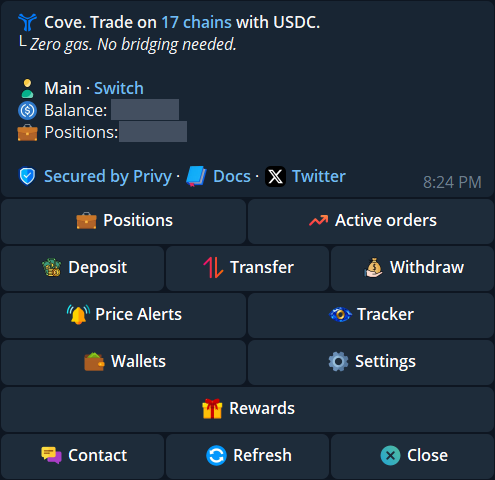
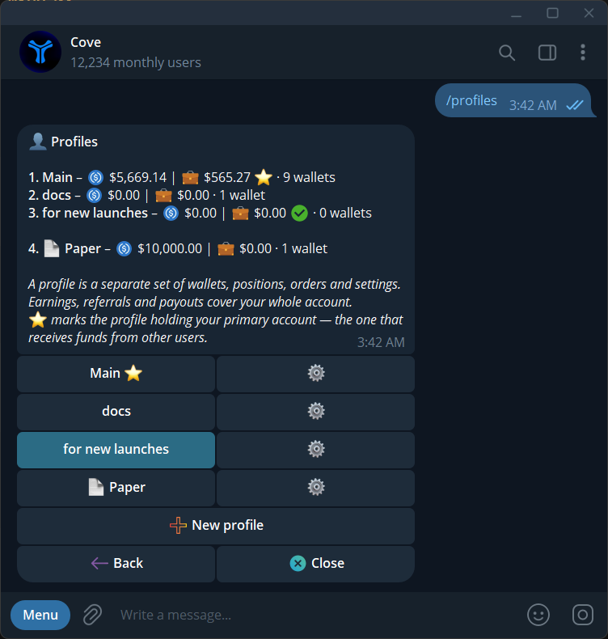

Cove runs in Telegram messages with buttons. Send `/start` to return home or `/help` to see commands.

## Main menu

| Button or line | What it opens or means |
|---|---|
| **Profile → Switch** | [Profiles](/essentials/profiles) |
| **Balance** | Spendable USDC in this profile |
| **Positions** | [Holdings and PnL](/features/positions) |
| **Active orders** | [Active orders](/features/managing-orders) |
| **Deposit / Transfer / Withdraw** | Add or send funds |
| **Price Alerts** | [Token price alerts](/features/price-alerts) |
| **Tracker** | [Trader and wallet alerts](/features/trader-alerts) |
| **Rewards** | [Referrals and rewards](/features/referrals) |
| **Wallets** | [Wallet management and trading selection](/essentials/accounts) |
| **Settings** | [Trading, display, receiving, and security preferences](/features/settings) |
| **Chains / `/chains`** | [Current recognized network list](/essentials/supported-chains) |
| **Contact** | [Support tickets](/features/support) |
| **Refresh / Close** | Refresh values or dismiss the message |

  <Frame caption="The November main menu. Balance and position values are hidden in this screenshot.">
    
  </Frame>

**Back** returns to the previous panel. **Close** dismisses a message; it does not cancel a trade or order. Telegram may not allow older messages to be deleted.

## Token panel

Paste an address or open a ticker in Positions. The panel contains buy/sell actions, slippage, charts, alerts, **Limit**, and **Strategy**. On the sell side, Limit has **Limit**, **DCA** (Price ladder), **Dev Sell**, and **Trailing SL**. Strategy has **Counter Strategy** and **DCA Time Interval**. On the buy side, Limit has Limit and DCA; Strategy opens DCA Time Interval. **Manage Position** opens a Mini App when enabled.

See [Read the token panel](/features/token-panel) for its fields.

## Profiles versus wallet selection

The **Active** profile button changes the wallets and settings you are using. The wallet picker selects which wallets *inside that profile* trade together.

If you switch profiles, reopen old trading or transfer panels. Their controls may belong to the previous profile.

{/* Screenshot: navigation-profile-picker.png | The Profiles menu shows balances, wallet counts, and the active profile. */}

  <Frame caption="The Profiles menu shows balances, wallet counts, and the active profile.">
    
  </Frame>

## Mini Apps, chains, and shortcuts

[Mini Apps](/essentials/mini-apps) provide visual positions, history, funding, and wallet management.

For ordinary token trading, the token determines the chain. If an address matches several networks, cove asks which one you mean. For an Arc token, choose **Arc** and check the chain shown on the panel. Send `/chains` to see recognized networks, then check the current trading, deposit, or withdrawal panel for the route you need. See [Supported chains](/essentials/supported-chains).

Use [Discovery](/features/token-discovery) to open **Trending**, **Runners**, or **Search** by ticker or name. Their rows open token panels; always verify the token address and chain.

Use [Commands](/help/commands) for direct shortcuts, [Settings](/features/settings) for layout changes, and `/bots` for the primary and backup bot handles. Telegram's theme controls the bot appearance.
