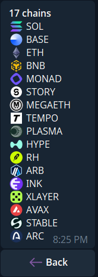
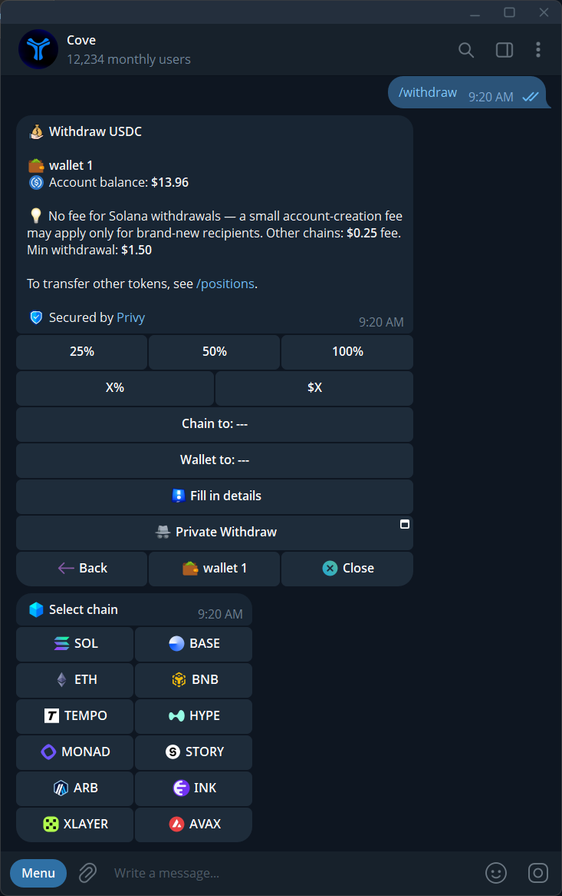

cove uses a **USDC trading balance on Solana** to trade supported tokens on multiple networks. Send `/chains` for the current list of networks the bot recognizes. The list shows **17 names** in the November 6, 2026 capture. Recognition does not mean that every token, deposit, withdrawal, or trading route is available on that network.

The token determines the trading chain; an ambiguous address opens a chain picker. Check the current panel before trading, depositing, or withdrawing.

  <Frame caption="The /chains response on November 6, 2026, including Story and Arc.">
    
  </Frame>

## Network reference

| Chain | Deposit address to use |
|---|---|
| Solana | Solana |
| Story | Check the current bot; its trading route was not active in this review |
| Ethereum | Deposit EVM |
| Base | Deposit EVM |
| BNB Chain | Deposit EVM |
| Arbitrum | Deposit EVM |
| MegaETH | Deposit EVM |
| Plasma | Deposit EVM |
| HyperEVM | **Show HyperEVM wallet** |
| Monad | Deposit EVM |
| RobinHood Chain | Deposit EVM |
| Tempo | Deposit EVM |
| Stable | Deposit EVM |
| Ink | Deposit EVM |
| X Layer | Deposit EVM, if available |
| Avalanche | **Show Avalanche wallet** |
| Arc | Check the **Deposit** panel for available funding routes |

<Note>
This table is a funding orientation for the names shown in `/chains`, not a promise that each route is open. X Layer is available only where the matching route appears in your bot. Marketplace and private withdrawals have their own supported-network lists.
</Note>

Story appears in `/chains`, but the production route was gated off in the reviewed build. Its [historical network guide](https://www.cove.trade/chains/story) describes the earlier integration. Check the current token panel before assuming Story can be traded.

For token-specific workflows and risk checks, browse the [Cove network guides](https://www.cove.trade/chains).

{/* Screenshot: chains-withdraw-menu.png | The network picker for a withdrawal; available destinations are shown here. */}

  <Frame caption="The network picker for a withdrawal; available destinations are shown here.">
    
  </Frame>

## Trade tokens on Arc

1. [Add USDC on Solana](/essentials/getting-started) to your Cove trading balance.
2. Paste the Arc token's contract address into Cove. If a chain picker appears, choose **Arc**.
3. Check that the panel shows **Arc**, verify the token address, and follow the [buy and sell guide](/features/trading).

You do not need to fund Arc directly to follow this trading flow. For links that open an Arc token panel, use chain code **`c`**; see [Deep Links](/builders/deep-links#chain-codes).

## Bridge minimums

Other-chain stablecoins need **\$25 on Ethereum** or **\$1 on other supported chains** for the documented bridge routes. Smaller balances remain below the minimum until topped up. [Manual bridge mode](/funds/bridge) also requires approval.

## Special addresses matter

HyperEVM and Avalanche use chain-specific wallet addresses. Sending a different chain's asset to one of those addresses can make funds inaccessible. Always copy a fresh address from the matching deposit panel.
