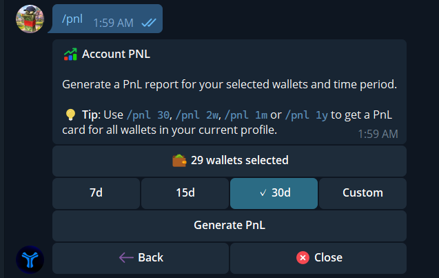
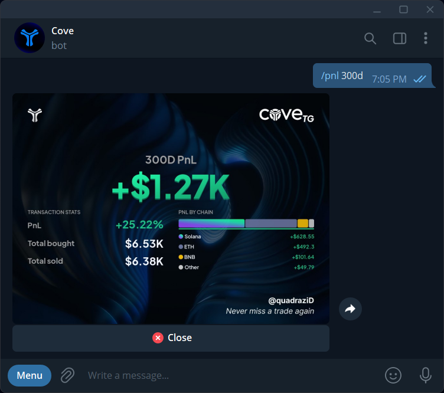

Send `/pnl` in your private chat with cove to create a report for **real wallets in the current profile**. This command appears only when the feature is enabled for your account. It is separate from **Generate PnL** on a single token panel.

## Generate a report

1. Send `/pnl`. The panel starts with **30d** selected.
2. Tap **wallets selected** to include or exclude wallets. The picker can include deleted wallets so their past trades count.
3. Choose **7d**, **15d**, **30d**, or **Custom**. Custom accepts a whole-day period from **1 to 365 days**; for example, `30`, `2w`, `1m`, or `1y`.
4. Tap **Generate PnL** and wait for the image. A direct command such as `/pnl 300d` generates a report for all real wallets in the current profile.

  <Frame caption="Select wallets and a rolling time period before generating the report.">
    
  </Frame>

The period is a rolling number of **24-hour days** ending when you request the card, rather than calendar-day buckets. Paper wallets are excluded.

## Read the card

The headline is **realized PnL on sells** in the period. The percentage compares that realized PnL with the cost basis assigned to those sells. The card also shows total bought, total sold, and a by-chain breakdown when there is activity. Unsold holdings are not marked to their current value here. Sells without a usable cost basis are excluded; if the missing basis prevents a reliable report, cove may say the report is unavailable.

  <Frame caption="A 300-day report shows realized PnL, return, bought and sold totals, and a breakdown by chain. These are the example account's figures.">
    
  </Frame>

This card answers a different question from [position PnL](/features/positions) and a [single-token share card](/features/pnl-cards). For a report that is still generating, wait instead of requesting it repeatedly. If your profile or wallets changed while the panel was open, reopen `/pnl` and choose them again.
