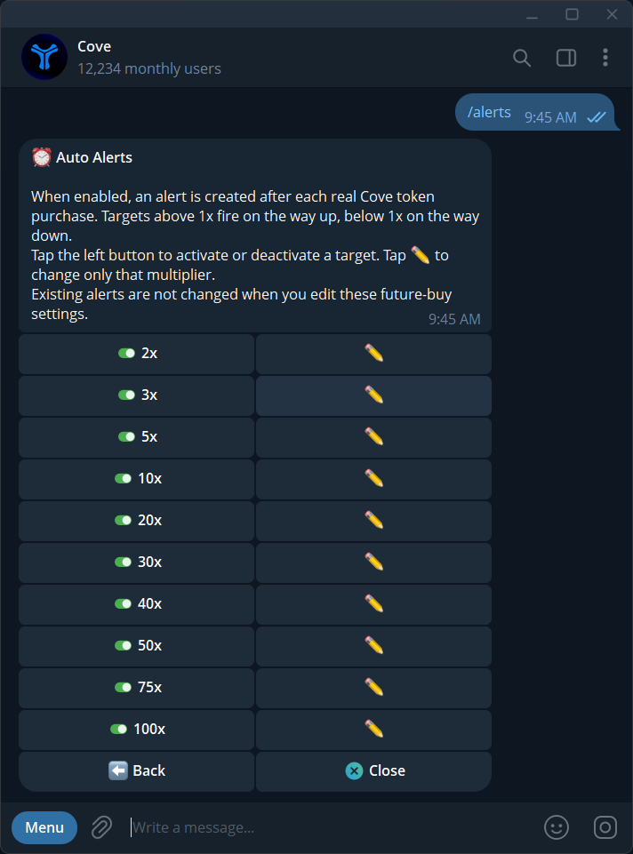

Auto alerts create targets after each **real Cove token purchase**, including eligible filled Limit and DCA buys. They notify you without trading and apply across profiles. A new buy can renew the token's active ladder.

## Set up future-buy alerts

<Steps>
  <Step title="Open Auto alerts">
    Send `/alerts` and open **Auto alerts**.
  </Step>
  <Step title="Enable the feature">
    Turn **Auto alerts** on.
  </Step>
  <Step title="Choose targets">
    Toggle or edit the target multiples. The default target list is **2×, 3×, 5×, 10×, 20×, 30×, 40×, 50×, 75×, 100×**.
  </Step>
  <Step title="Review the meaning">
    Above **1×** means an upward target; below **1×** means a downward target. Inputs can include **7x**, **0.7x**, **+50%**, or **-30%**.
  </Step>
</Steps>

{/* Screenshot: alerts-auto-settings.png | Auto alerts: enable the feature and edit the gain multiples for future buys. */}

  <Frame caption="Auto alerts: enable the feature and edit the gain multiples for future buys.">
    
  </Frame>

An illustrative purchase at **100k** market cap has a **2× target at 200k** and a **0.7× target at 70k**.

## Existing versus future alerts

Changing future-buy settings does **not** change alerts already created. Inspect existing token alerts separately.

For a token you want to rebase, choose **Reset from current MC** in its auto-alert controls. The notification will then refer to the reset rather than the original buy.

## How long a ladder stays active

Each real buy grants its token's ladder an initial **five-day** term. At the term boundary, Cove renews it for another five days when the token is still **visible in `/positions`** and its displayed worth is at least **\$50**. The renewal check uses the position filters of the wallets that hold it. Hiding the token, filtering it out, or falling below the threshold can let the ladder expire at the next term boundary; a change in the middle of a term does not end it immediately. There is no backfill for missed triggers.

Renewed ladders use a slower price check than first-term ladders, so an alert can arrive later than the instant a target is crossed. Auto alerts also retire after you fully exit a position.

Cove covers up to **50 tokens** with active auto-alert ladders. If a new buy would exceed that cap, an older or lower-worth ladder can be displaced; the new buy's ladder is kept. Check `/alerts` to see which tokens remain armed.

If the system ended a held token's ladder, the market token panel can show **Auto alerts off · Re-enable**. Tapping it arms a fresh ladder from the current targets and starts a new term. It does not replay earlier prices. A ladder you cancelled yourself does not get that one-tap recovery offer.

Turning off Auto alerts stops future automatic creation; manage existing alerts in `/alerts` as needed. Use [manual price alerts](/features/price-alerts) when you want a specific independent target.
