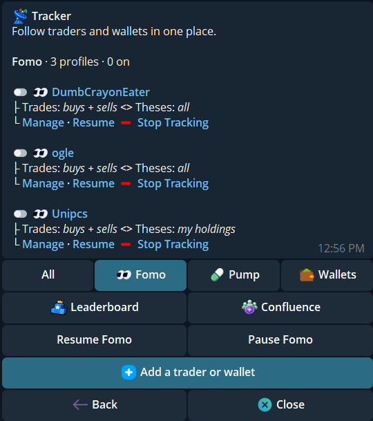
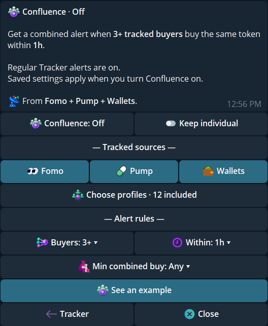
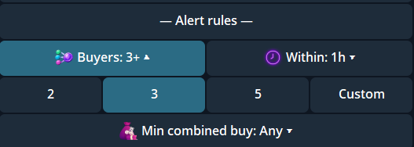
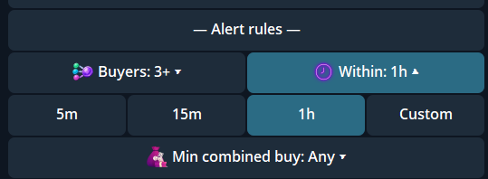
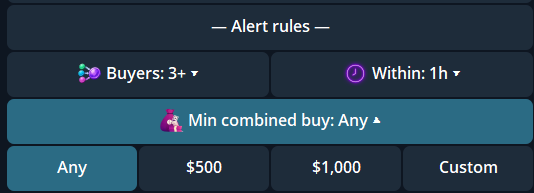
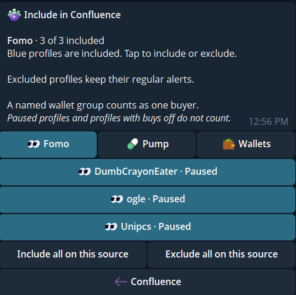
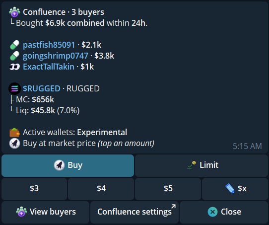

Confluence brings eligible **buy alerts** from your selected Fomo traders, Pump.fun traders, and tracked wallet groups into one notification. Set a buyer count, a time window, and an optional minimum combined buy. Cove sends a Confluence alert when **all three conditions** are met for the same token on the same chain. It does not place a trade.

<Note>Confluence starts **off**. Your regular Trader Tracker alerts continue until you choose a Confluence mode. You need tracked profiles with buys enabled before the rule can match.</Note>

<Columns cols={2}>
  <Card title="Confluence only" icon="layer-group">
    Receive combined buy alerts from your selection. Individual Tracker buys, sells, and theses are off for every tracked profile while this mode is active.
  </Card>
  <Card title="Confluence + individual" icon="bell">
    Keep your regular Tracker alerts from all profiles and add combined buy alerts from the selected profiles.
  </Card>
</Columns>

## Turn it on

<Steps>
  <Step title="Open Tracker">
    Send `/track`, then tap **Confluence** beneath the source tabs and Leaderboard.
  </Step>
  <Step title="Choose what counts">
    Leave **Fomo**, **Pump**, or **Wallets** highlighted to include those sources. Open **Choose profiles** to include or exclude individual traders and wallet groups. Selected sources count together.
  </Step>
  <Step title="Set the rule">
    Choose **Buyers**, **Within**, and **Min combined buy**. The saved values are visible while Confluence is off and take effect when you turn it on.
  </Step>
  <Step title="Choose delivery">
    Turn **Confluence** on. Leave **Keep individual** off for combined alerts only, or turn it on to keep your existing individual Tracker alerts as well. Review the status at the top of the panel.
  </Step>
  <Step title="Try the example">
    Tap **See an example** and step through sample buys to see whether your current selection and filters would send individual or combined notifications. The preview makes no trades or orders.
  </Step>
</Steps>

  <Frame caption="Find Confluence in the unified Tracker, below the Fomo, Pump, and Wallets tabs.">
    
  </Frame>

  <Frame caption="The Confluence panel shows its delivery mode, sources, included profiles, and all three rule fields. Values shown are this account's saved choices.">
    
  </Frame>

## Set the three alert rules

| Rule | What Cove checks | Choices |
|---|---|---|
| **Buyers** | Different eligible buyers of the same token | **2**, **3**, **5**, or Custom **2–50**; starts at **3+** |
| **Within** | Time between qualifying buys | **5m**, **15m**, **1h**, or Custom **1m–24h**; starts at **1h** |
| **Min combined buy** | Sum of qualifying buy amounts in USD | **Any**, **\$500**, **\$1,000**, or Custom; starts at **Any** |

**Any** removes the dollar minimum only. It does not remove the buyer-count or time-window rules. Custom amounts accept values such as `500`, `2.5k`, or `$1m`; a custom time can be `15m` or `2h`.

  <Frame caption="Choose 2, 3, 5, or a custom minimum buyer count.">
    
  </Frame>

  <Frame caption="Choose 5 minutes, 15 minutes, 1 hour, or a custom window.">
    
  </Frame>

  <Frame caption="Choose no dollar minimum, a preset, or a custom amount.">
    
  </Frame>

For example, **3+ buyers · \$1,000 minimum · 1h** needs three different eligible buyers whose qualifying purchases of the same token total at least \$1,000 within one hour. Three buys by one trader still count as **one buyer**; those buys can add to the dollar total.

## Choose profiles and understand the count

Tap **Choose profiles** and switch between the included source tabs. Blue profiles are selected; tap one to include or exclude it. **Include all** and **Exclude all** affect the current source. You must keep at least one source selected while Confluence is on.

  <Frame caption="Choose profiles within each source. A named wallet group counts once, even when several of its addresses buy.">
    
  </Frame>

- A Fomo trader, Pump.fun trader, or **named wallet group** counts as one buyer. Repeated buys add to its amount, not its buyer count.
- Cove avoids counting known shared wallets twice when profiles overlap.
- Paused profiles and profiles with **Buys off** do not count. Their existing trade and token filters still apply, including **Min buy** and **Only on my holdings** where set.
- In **Confluence only**, excluded profiles send no individual Tracker alerts. In **Confluence + individual**, excluded profiles keep their regular alerts but do not contribute to combined alerts.
- If too few eligible buyers remain, the panel shows **Waiting**. Include more profiles, lower the buyer minimum, or use **Confluence + individual**. Cove will not send a combined alert until the rule can be met.

Changing a rule, source, profile selection, pause state, or relevant filter starts a fresh collection window. Older trades are not replayed. Cove sends at most **one Confluence alert per token per window**. [Price alerts](/features/price-alerts) and order updates are separate from Tracker delivery.

## Read and act on the alert

The notification shows the number of buyers, their combined purchase amount, the rule window, the first three contributing profiles, and token market data when available. **View buyers** opens the full buyer and wallet snapshot; its details are available for **30 days**. If some purchase amounts are unavailable, the alert marks them as unavailable.

  <Frame caption="Illustrative Confluence delivery. This sample uses a 24-hour rule and is not a real trade or order.">
    
  </Frame>

**Buy** amount buttons use the eligible market-buy presets; **Limit** amount buttons use the eligible Limit-buy presets from your trading settings. These amounts are not a separate Confluence setting. **Limit** opens the custom limit flow; it does not place an order when the alert arrives. Review the active wallets, token, amount, and live quote before tapping a trade action. See [Trader Tracker alert actions](/features/trader-alerts#act-on-an-alert) for the preset and wallet rules.

**Confluence settings** returns to the rule panel. Turning Confluence off restores regular Tracker delivery with each profile's saved settings. Existing price alerts and placed orders are unaffected.
