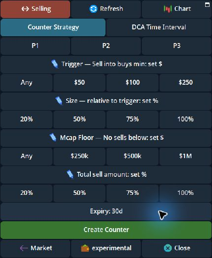
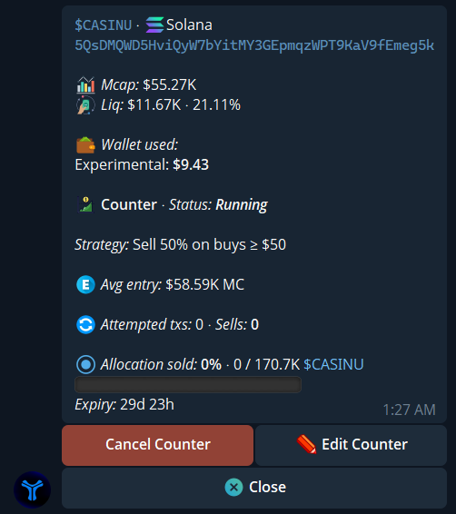
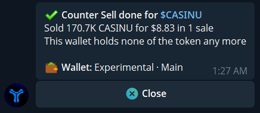

**Counter Sell** watches buys of a token by other traders. When a qualifying buy is observed, Cove attempts a market sale from the wallets you selected. It can respond to several buys until your total sell limit is reached or the order ends.

<Warning>Counter Sell acts after another trader's buy. A buy is not a guaranteed sale: the signal, market-cap floor, minimum trade size, liquidity, slippage, and your remaining holding can prevent execution. The trigger is not a promised fill price.</Warning>

## Set up a Counter Sell

1. Open a token you hold in the intended profile. Choose the wallets to include, then tap **Selling → Strategy → Counter Strategy**.
2. Set **Trigger — Sell into buys min**. Choose **Any** to evaluate buys of any size, or enter a minimum such as **\$50**. A sale below the minimum trade size is still skipped.
3. Set **Size — relative to trigger**. For example, **75%** of a qualifying **\$100** buy asks cove to sell roughly **\$75** of your tokens at the market quote, subject to the remaining sell limit and holdings.
4. Set **Mcap Floor — No sells below** to **Any** or a market cap. The floor decides whether to attempt a sale; it does not set a minimum execution price.
5. Set **Total sell amount** to cap how much of the selected wallets' combined holding this strategy may sell. Review the **30-day** default expiry and tap **Create Counter** only when ready. All four required values open blank unless you recalled [P1–P3 or Last used values](/features/order-presets).

Each value has quick presets and a row you can tap to enter a custom value. A 75% size is relative to *each other trader's buy*; a 100% total is a limit across the whole strategy. These controls answer different questions.

{/* Screenshot: counter_strategy_blank_p123_2026_11.png | Counter Strategy blank fields and P1–P3. */}

  <Frame caption="Counter Strategy opens with blank values for trigger, size, market-cap floor, and total sell limit.">
    
  </Frame>

## Understand the total limit

The total percentage applies to the bag held by the wallets selected for this Counter Sell. Sales made by hand or by another order also count toward it. Buying more tokens in those wallets can increase the amount available to the strategy; selling them reduces what remains. If a buy arrives while this Counter Sell is already attempting a sale, it is skipped rather than queued.

Only one Counter Sell can run for a token. Its selected wallets are fixed; to change them, cancel and create a new strategy. Each attempted sale can have trading costs, so a low minimum buy on an active token may lead to many small trades.

## Check, edit, or stop it

Open the token's **Active Orders → Counter → View details**, or find it with `/orders`. The detail shows its status, settings, attempted trades, amount sold, and expiry. Use **Edit Counter** to change the four value controls; confirm the changes on the edit screen. **Cancel Counter** stops future attempts but does not undo sales already made. **Token panel** opens a new panel for that token; it does not change the order.

{/* Screenshot: counter_sell_active_2026_10.png | Running Counter Sell details. */}

  <Frame caption="A running Counter Sell shows its strategy and allocation already sold.">
    
  </Frame>

After completion, Cove sends a result with the tokens sold and proceeds. Review the trade receipt and remaining position. An ended order's summary can remain accessible until you dismiss it; **Close** on a message only closes that message.

{/* Screenshot: counter_sell_finished_2026_10.png | Counter Sell completion message. */}

  <Frame caption="Example Counter Sell completion message.">
    
  </Frame>

For other exits, compare [Dev Sell](/features/dev-sell), [Trailing stop](/features/trailing-stop), and [DCA orders](/features/dca-orders). See [Manage orders](/features/managing-orders) for shared status and cancellation guidance.
