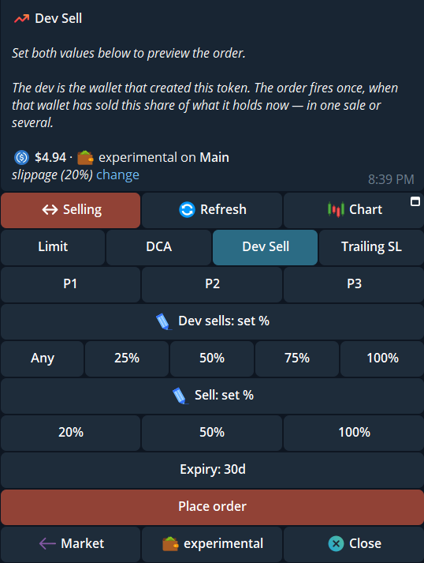
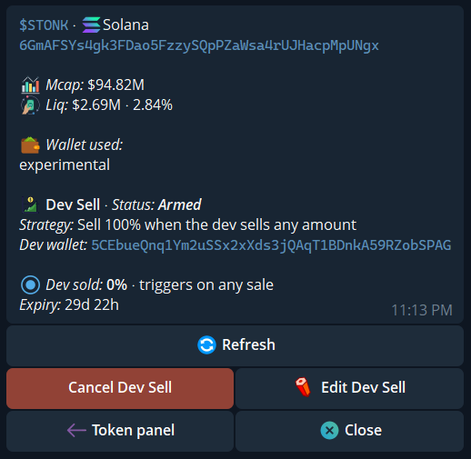
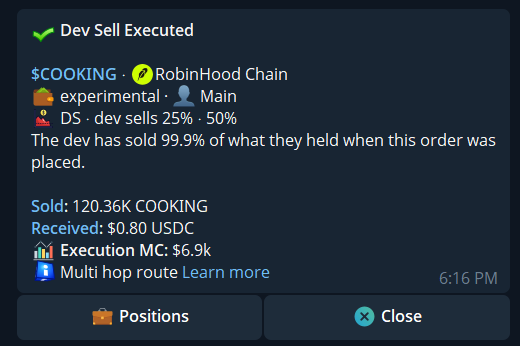

**Dev Sell** is a pending sell order for a token you hold. It watches a sale attributed to the token's creator wallet after you place the order. It also checks how far that wallet's token balance has fallen from the balance saved at placement. A transfer alone is not a sale.

<Warning>A Dev Sell order reacts after a creator sale. It cannot sell before that transaction, guarantee a price or prevent every loss. Route availability, liquidity, price impact, and your remaining position still determine whether an exit can execute.</Warning>

## Choose the trigger and your sell size

In the Telegram token panel, open **Limit → Selling → Dev Sell**. The two percentages refer to different wallets:

| Control | Meaning |
|---|---|
| **Dev sells** | The creator wallet's net token-balance decrease relative to its balance when you placed the order. **Any** accepts a qualifying sale of any size; presets include **25%**, **50%**, **75%**, and **100%**. |
| **Sell** | The percentage of **your remaining position** Cove attempts to sell once the trigger is met. |

For example, **Dev sells 25%** and **Sell 50%** means Cove waits for the creator's net balance to fall by the threshold after a qualifying sale, then attempts to sell half of your position remaining at that point. The creator can reach the threshold across several sales. The percentage is measured from the creator's balance at order placement, not the token's total supply.

Both required fields open blank unless you recalled [P1–P3 or Last used values](/features/order-presets). **Any** and **100%** are quick choices, not preselected values. Set both, then review the selected wallets, token, and expiry before tapping **Place order**. cove attempts one order per selected wallet. If the creator wallet or a usable starting balance cannot be identified, the manual order is not placed and cove gives a reason.

{/* Screenshot: dev_sell_blank_p123_2026_11.png | Dev Sell blank fields and P1–P3. */}

  <Frame caption="Dev Sell has empty required fields, quick choices, and P1–P3 slots.">
    
  </Frame>

## Check and manage the order

Open the token panel's **Active Orders → DS → View details**, or find the pending **DS** entry in `/orders`. The detail screen shows whether it is armed, the trigger and your sell size, the creator wallet, expiry, and progress toward the creator's balance-drop threshold. **Refresh** reads the latest progress; the open message does not update itself. You can cancel or edit **Trigger**, **Sell**, and **Expiry** while the order runs. **Token panel** opens a new panel for that token; it does not change the order. The creator address and starting balance were fixed at placement; editing the percentages does not change that baseline. If placement status is uncertain, check `/orders` before trying again.

If the order sells, its result may remain on the token panel until dismissed. Read the sale receipt and remaining position. **Close** dismisses the current message; it does not cancel a running order.

{/* Screenshot: dev_sell_active_2026_10.png | Armed Dev Sell detail. */}

  <Frame caption="An armed Dev Sell shows its trigger, progress, and controls.">
    
  </Frame>

{/* Screenshot: dev_sell_finished_2026_10.png | Dev Sell execution summary. */}

  <Frame caption="Example Dev Sell execution summary.">
    
  </Frame>

A trigger begins an execution attempt; it is not the same as a filled sale. A creator sale can move the market before Cove responds. Price-impact checks may require your decision, and a route or liquidity failure can leave the position unsold. Check the order's status, trade receipt and remaining holding before placing another exit.

## Auto Dev Sell for future buys

Open **Settings → Trade panel settings → Auto orders → Auto Dev Sell**. **Market buys** and **Limit & DCA** have separate settings; a filled DCA rung or breakout buy belongs to the latter group. **Auto Dev Sell starts Off**. When enabled, it tries to place a Dev Sell order after a future eligible buy fills. Turning it on does not add orders to holdings you already have.

If the token has no usable creator-wallet information or balance, an automatic order may not be created. After a buy, open `/orders` and verify the actual DS order. An enabled setting alone does not prove protection is active.

For other exit conditions, see [Take-profit and stop-loss](/features/take-profit-stop-loss), [Trailing stop](/features/trailing-stop), and [Manage orders](/features/managing-orders).
