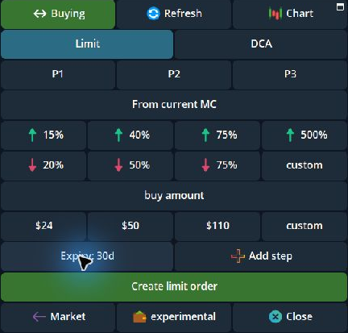
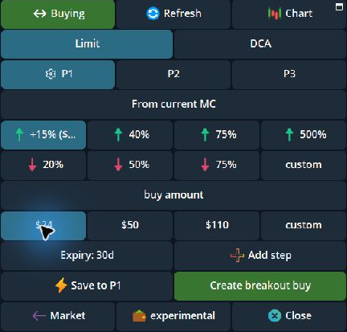
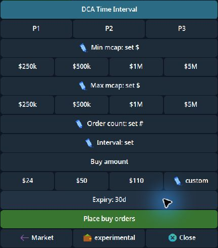
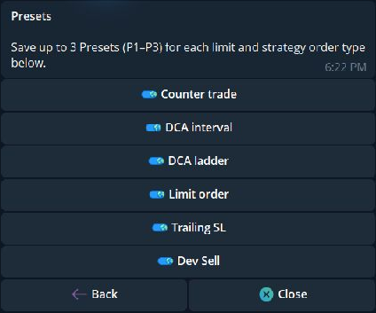
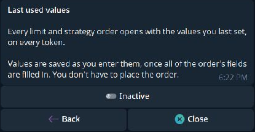

Order Presets save a complete set of order-form values under **P1**, **P2**, or **P3**. They are different from the quick trigger and amount buttons: those buttons enter one value, while a saved P1–P3 preset recalls a whole form. Open a token → **Limit** or **Strategy** to use them.

## Where P1–P3 appear

| Order form | Side | Values a preset can recall |
|---|---|---|
| **Limit** | Buy and sell | Up to three steps, triggers, amounts, sell style where relevant, and expiry |
| **DCA** price ladder | Buy and sell | Minimum and maximum market cap, order count, total amount, and expiry |
| **DCA Time Interval** | Buy and sell | Market-cap bounds, order count, interval, total amount, and expiry |
| **Counter Strategy** | Sell | Minimum other-trader buy, sell size, market-cap floor, total sell amount, and expiry |
| **Trailing SL** | Sell | Trail percentage, sell percentage, and expiry |
| **Dev Sell** | Sell | Creator-sale threshold, your sell percentage, and expiry |

Each side has its own P1–P3. The form opens without a selected preset. With **Last used values** inactive, its required fields start blank. The quick buttons below each field remain available, but they do not mean a value has been selected.

  <Frame caption="A Limit buy opens with P1–P3 and empty trigger and amount fields.">
    
  </Frame>

## Save and recall a form

1. Tap **P1**, **P2**, or **P3**. An empty slot selects that slot and keeps the current form values. A saved slot loads its values.
2. Complete every required field. **Save to P1** (or the selected slot) appears beside the create button when the form can be saved.
3. Tap **Save to P1** to store the form. Tap the create button separately if you also want to place an order. Creating an order does **not** save a preset.
4. When you revisit the form, tap the same P slot to recall it. Tapping the selected slot again restores its saved values if you edited them, or deselects it if nothing changed.

The screenshot below stops before both actions. Selecting values for a screenshot did not place an order or save P1.

  <Frame caption="After choosing a trigger and amount, Save to P1 appears beside Create breakout buy.">
    
  </Frame>

**Expiry** and **Add step** are part of the Limit form. A saved Limit preset may contain up to three steps. Review every step after recall before creating orders.

  <Frame caption="P1–P3 also appear on DCA Time Interval, with market-cap bounds, order count, and interval.">
    
  </Frame>

## Show or hide preset rows

Open `/settings` → **Trade panel settings → Buttons and controls → Order Presets**. Switch **Counter trade**, **DCA interval**, **DCA ladder**, **Limit order**, **Trailing SL**, or **Dev Sell** separately. Turning one off hides its P1–P3 row; it does not delete saved values. The switches are on by default, but check your saved state.

  <Frame caption="Order Presets has one switch per order type.">
    
  </Frame>

## Last used values

Open **Buttons and controls → Last used values**. When **Active**, each Limit or Strategy tab reopens with the last complete values you entered, even on another token; you do not need to place an order for those values to be remembered. When **Inactive**, the tab opens blank unless you choose P1–P3. Inactive is the default.

  <Frame caption="Last used values is a separate setting; this example is Inactive.">
    
  </Frame>

Presets and Last used values belong to your **login** across profiles; Paper has a separate set. A recalled fixed market cap keeps its dollar value on a different token. Check the new token's current market cap and the preview: an intended dip buy can become a **Breakout** buy when its target sits above the current market, and a DCA ladder can place rungs on a different side of the market. See [Limit orders](/features/limit-orders) and [DCA orders](/features/dca-orders) before submitting.
