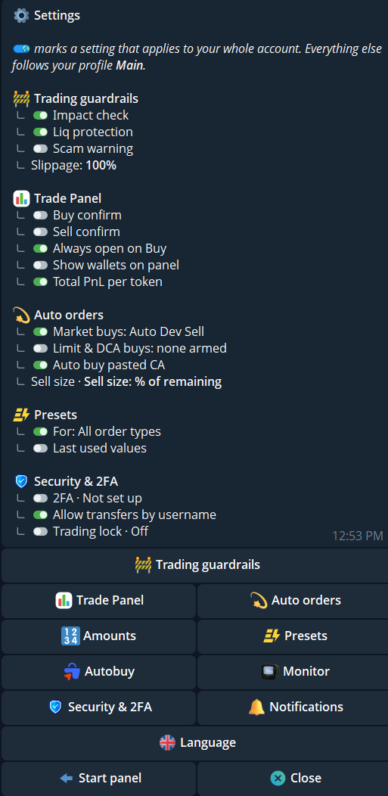

Send `/settings` and check the active profile shown at the top. The main menu now places the most used controls directly in **Trading guardrails**, **Trade Panel**, **Auto orders**, **Amounts**, **Presets**, **Autobuy**, and **Monitor**. Security and notification choices are below them.

  <Frame caption="Current Settings menu. The values shown are saved choices for this account, not recommended defaults.">
    
  </Frame>

## Where to go

| Button in `/settings` | What it opens |
|---|---|
| **Trading guardrails** | [Slippage, scam warnings, liquidity and impact checks, trade-size confirmations, gas surplus, and group-link trading](/features/settings/guardrails) |
| **Trade Panel** | [Buy/Sell confirmation, wallet visibility, PnL display, Capital Display, chart and extra links](/features/settings/trade-panel) |
| **Auto orders** | [Separate automatic exit templates for Market buys and Limit & DCA fills](/features/settings/auto-tp-sl) |
| **Amounts** | [Market Buy/Sell buttons, Limit amounts and trigger presets, and quick Sell links](/features/settings/trade-panel#amounts-and-limit-triggers) |
| **Presets** | [Saved P1–P3 order forms and Last used values](/features/order-presets) |
| **Autobuy** | [Auto-buy on paste, its amount, market-cap and liquidity bounds, and Skip holdings](/features/settings/auto-buy) |
| **Monitor** | [Recent-token or Positions shortcuts at the top of a market token panel](/features/settings/trade-panel#monitor) |
| **Security & 2FA** | [Receive transfers, two-factor authentication, and Trading lock](/features/settings/security) |
| **Notifications** | [Telegram updates and optional Pushover phone alerts](/features/settings/notifications) |
| **Language** | [English or Chinese](/features/settings/language) |

The **Panel settings** button in `/positions` opens position-list controls, including Sell 100% links and confirmation. See [Position display and filters](/features/settings/position-panel). Token-panel **Customize** can open the same Trade Panel options in context.

## Which settings follow your profile?

Look for the profile mark beside a setting and check the profile name before editing. Trading risk controls, quick trade amounts, Auto orders, Autobuy, and Monitor can differ between profiles. Saved **P1–P3 order presets** and **Last used values** follow your login across profiles; Paper has its own set. Security and language apply to the login.

Profiles can [copy trading settings](/essentials/profiles) when created. A display choice changes the panel you see; an execution choice can affect the next trade. Reopen a stale panel before changing it.

## Settings reached elsewhere

| Preference | Where to change it |
|---|---|
| Trading wallets | `/wallets` or the trading panel's wallet selector |
| Split Total / Per Wallet, variance, delay, primary first | [Multi-wallet preferences](/features/multi-wallet-trading) |
| Position filters, hidden tokens, and sort order | `/positions` → **Filters**, **Hidden**, or **Sort** |
| Manual and automatic token price alerts | `/alerts` → [Alerts](/features/price-alerts) or [Auto alerts](/features/auto-alerts) |
| Trader and wallet notification rules | `/track` → [Tracker](/features/trader-alerts) or [Confluence](/features/confluence) |
| Profile name, copying settings, archive/restore | `/profiles` |
| Agent permissions and spending limits | [MCP guide](/builders/mcp-tools) |

Market and Limit amount screens offer **Reset defaults** for their own buttons. There is no single reset for every Cove setting. Check the resulting value after each edit.
