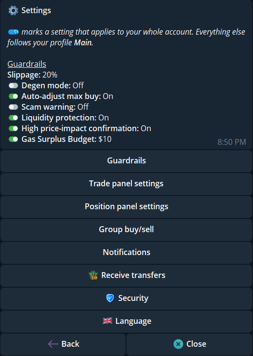

Send `/settings`. Check the active profile, then open a category and review its saved values before changing them. Some settings apply to the whole account, including Security.

{/* Screenshot: settings_root_2026_11.png | Settings menu, including Receive transfers and Security. */}

  <Frame caption="Settings categories, including Receive transfers and Security.">
    
  </Frame>

## Choose a category

<Columns cols={2}>
  <Card title="Guardrails" icon="shield-halved" href="/features/settings/guardrails">Slippage, scam warnings, price impact, large-trade confirmation, and gas budget.</Card>
  <Card title="Trade panel" icon="sliders" href="/features/settings/trade-panel">Market buttons, Order Presets, Last used values, Positions Monitor, and confirmations.</Card>
  <Card title="Positions" icon="chart-pie" href="/features/settings/position-panel">Sell links, confirmation, filters, and sorting.</Card>
  <Card title="Group buy/sell" icon="users" href="/features/settings/group-links">Control trading actions opened from shared links.</Card>
  <Card title="Notifications" icon="bell" href="/features/settings/notifications">Telegram auto-bridge updates and optional Pushover alerts.</Card>
  <Card title="Receive transfers" icon="arrow-down" href="/features/settings/receive-transfers">Choose who can send USDC to your Telegram handle.</Card>
  <Card title="Security" icon="shield-halved" href="/features/settings/security">2FA, trading lock, and recovery email.</Card>
  <Card title="Language" icon="language" href="/features/settings/language">Switch between English and Chinese.</Card>
</Columns>

## Current Settings tree

| From `/settings` | Open next | What is inside |
|---|---|---|
| **Guardrails** | Slippage and safety controls | Degen mode, Slippage, Auto-adjust max buy, Scam warning, Liquidity protection, High price-impact confirmation, **Large Buy/Sell confirm**, Gas surplus budget |
| **Trade panel settings** | **Buttons and controls** | Market preset amounts; Limit preset amounts; **Order Presets**; **Last used values**; **Positions Monitor**; Buy/Sell confirm, Max buy, Nest accounts, Mini App, Chart, DexScreener chart |
| **Trade panel settings** | **Text panel** | Total PnL per token, Capital at Risk / Profit Taken, Extra links, Sell link presets |
| **Trade panel settings** | Other entries | Auto orders → Market buys or Limit & DCA → Auto take profit, Auto stop loss, Auto trailing stop, Auto Dev Sell; Manual TP/SL basis; Always open on Buy; Auto-buy on paste |
| **Position panel settings** | Position controls | Sell 100% links and Positions sell confirmation; position filters and sorting are in `/positions` |
| **Group buy/sell** | Group controls | Group buy maximum and Group sell |
| **Notifications** | Telegram / Pushover | Auto-bridge Telegram DM toggle; Pushover categories and delivery settings where offered |
| **Receive transfers** | Recipient policy | On/off, Everyone or Allow-list only, and allowed Telegram handles |
| **Security** | Open Security | 2FA, optional Trading lock, and recovery email in Cove Wallets |
| **Language** | Language picker | English or Chinese |

The token panel has separate **Limit** and **Strategy** buttons. Limit's DCA tab is the Price ladder; Strategy contains DCA Time Interval and, on the sell side, Counter Strategy. These are trading controls, reached from a token panel rather than from Settings.

## Which settings change with a profile?

When you have several profiles, a **👤** mark identifies profile settings. Check the profile named in the settings panel before editing.

| Scope | Settings |
|---|---|
| **Active profile** | Guardrails, market and limit quick presets, buy/sell confirmations, Max buy, **Positions Monitor**, Auto orders for each buy mode, manual TP/SL basis, auto-buy, Always open on Buy, Positions sell confirmation, trading-wallet selection, and group-buy authorizations |
| **Whole login** | **Order Presets P1–P3 and Last used values** (Paper has a separate set), 2FA, trading lock, receive-transfer policy, language, Nest accounts, Mini App/Chart/DexScreener display, extra links, Total PnL per token, group-buy maximum, Group sell, notifications, position filters/sort, and price alerts |
| **Individual wallet** | Auto-bridge mode, label, and wallet-specific management |

For any control whose scope is not shown here, use its current 👤 indicator rather than assuming a change is device-only. Profiles can [copy trading settings](/essentials/profiles) from another profile when created.

## Settings outside the Settings menu

| Preference | Where to change it |
|---|---|
| Trading wallets | `/wallets` or the trading panel's wallet picker |
| Split Total / Per Wallet, variance, delay, primary first | [Multi-wallet preferences](/features/multi-wallet-trading) |
| Per-wallet auto-bridge | `/wallets` → **⚙️**, `/bridge`, or Deposit Mini App |
| Auto-alert targets | `/alerts` → [Auto alerts](/features/auto-alerts) |
| Position filters and sorting | `/positions` → **Filters / Sort** |
| Primary wallet and labels | `/wallets` → **⚙️** |
| Profile name, copying settings, archive/restore | `/profiles` |
| Agent permissions and spending limits | [MCP guide](/builders/mcp-tools) |

## Save, reset, and stale panels

Follow the requested input and check the resulting value. Market and limit preset screens offer **Reset defaults** for their own lists. There is no documented single reset that restores every Cove setting.

If a panel expires or belongs to another profile, reopen it before editing. A display setting changes what you see; an execution setting can change what happens on the next trade.

For a deliberate review before trading, enable **Buy confirm**, **Sell confirm**, and **Positions → Sell confirmation**.
