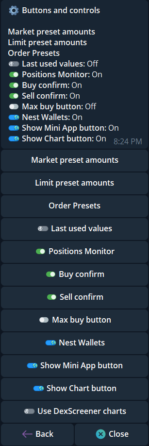
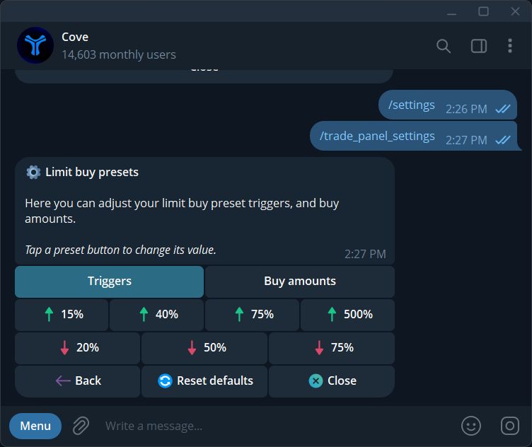
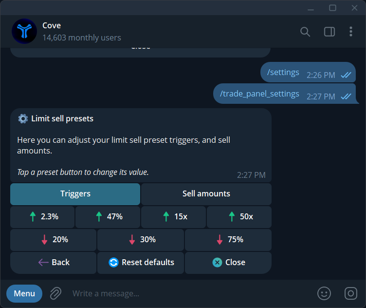
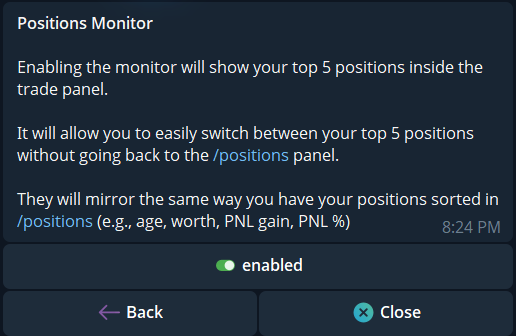

Open `/settings` → **Trade panel settings**, or send `/trade_panel_settings`. The current menu has **Buttons and controls**, **Text panel**, **Auto orders**, **Manual TP/SL basis**, **Always open on Buy**, and **Auto-buy on paste**.

## Change buy presets

<Steps>
  <Step title="Open market buy presets">
    Choose **Buttons and controls → Market preset amounts → Buy preset amounts**, then **Amount (\$)** or **Percent (%)** mode.
  </Step>
  <Step title="Edit a button">
    Tap the preset to change, send the requested value, and check the updated list. Percent mode uses buying power, not token holdings.
  </Step>
  <Step title="Review or reset">
    Reopen the token panel to see the new buttons. **Reset defaults** restores buy presets.
  </Step>
</Steps>

Documented default buy buttons are **\$50 / \$100 / \$250 / \$500 / \$1000**, or **10 / 25 / 50 / 75 / 100%** in percentage mode. Existing profiles may have custom values.

For sells, open **Buttons and controls → Market preset amounts → Sell preset amounts**, choose a button, and enter its percentage. The current default is **25 / 50 / 75 / 100%** in one row. Saved custom values can differ. Follow the input's validation.

{/* Screenshot: settings-buy-presets.png | Buy preset amounts с Amount/Percent, редактируемыми значениями и Reset defaults. */}
{/* Screenshot: settings-trade-panel.png | Trade panel settings, включая confirmations, buttons, text и automation. */}

## Change limit-order presets

Open **Buttons and controls → Limit preset amounts → Limit buy presets / Limit sell presets**. Each side has a **Triggers** tab with seven editable slots and an **Amounts** tab with three editable slots. Trigger presets accept upward or downward percentages or upward multiples such as **2x**. Buy amounts are USD; sell amounts are percentages of holdings. Use **Reset defaults** on the selected list if you want its original values.

The Limit builder uses these **quick** presets. The DCA panel uses the same three amount choices. [Order Presets P1–P3](/features/order-presets) save whole forms and have separate switches. See [Create limit orders](/features/limit-orders#edit-limit-presets).

[Trader Tracker](/features/trader-alerts#where-the-dollar-buttons-come-from) uses the first three eligible USD **market buy presets** under Buy and the first three eligible **Limit buy amounts** under Limit. Its alert takes a snapshot of those amounts and the selected wallets when the message is sent; changing presets updates future alerts.

{/* Screenshot: settings_buttons_controls_2026_11.png | Buttons and controls with quick presets, Order Presets, Last used values, and Positions Monitor. */}

  <Frame caption="Buttons and controls includes quick presets, Order Presets, Last used values, and Positions Monitor. This example shows saved choices, not defaults.">
    
  </Frame>

{/* Screenshot: settings_limit_buy_presets.png | Editable Limit buy trigger presets. */}

  <Frame caption="Editable Limit buy trigger presets.">
    
  </Frame>

{/* Screenshot: settings_limit_sell_presets.png | Editable Limit sell trigger presets. */}

  <Frame caption="Editable Limit sell trigger presets.">
    
  </Frame>

## Whole-form presets and last used values

Open **Buttons and controls → Order Presets** to show or hide P1–P3 separately for Limit, DCA ladder, DCA interval, Counter trade, Trailing SL, and Dev Sell. **Last used values** controls whether each form reopens with the last complete values you entered. Both apply across the login; Paper has its own values. See [Save order presets](/features/order-presets) for the save and recall flow.

## Positions Monitor

Open **Buttons and controls → Positions Monitor**. It is **off by default per profile**. When enabled and position data is available, the first row of an ordinary market Buying or Selling panel shows the open token and up to **five** other positions for quick switching. The row uses your `/positions` wallet, chain, visibility, and sort choices. A row with five or six tokens has arrows to switch pages. It is not shown in Limit, DCA, Strategy, wallet pickers, alerts, or slippage screens. If cove cannot read a complete position list, it omits the row instead of showing a partial one.

See the [Positions Monitor example in a live token panel](/features/token-panel#positions-monitor-in-the-market-panel) for the shortcut row and paging arrow.

  <Frame caption="Positions Monitor explains the top-five position shortcuts and shows the saved state for this profile.">
    
  </Frame>

## Buttons and confirmations

Open **Buttons and controls** for the switches below.

| Setting | Default | What it changes |
|---|---|---|
| **Buy confirm** | Off | Add a confirmation before a normal buy |
| **Sell confirm** | Off | Add a confirmation before a normal sell |
| **Max buy button** | Off | Show a full-buying-power button; Max always confirms |
| **Nest accounts** | Off | Put wallet selection behind a button |
| **Show Mini App button** | On | Show **Manage Position** |
| **Show Chart button** | On | Show the chart action |
| **Use DexScreener charts** | Off | Choose DexScreener instead of Defined; shown when Chart is on |

Normal confirmation preferences do not suppress mandatory risk or fee prompts. **Positions sell links** have their own [Sell confirmation setting](/features/settings/position-panel).

## Position text and links

Open **Text panel** for the options below.

| Setting | Default | What it changes |
|---|---|---|
| **Total PnL per token** | Off | Show lifetime PnL rather than the current holding cycle |
| **Capital at Risk / Profit Taken** | Off | Replace separate Cost/Sold lines with the summarized view |
| **Extra links** | Check your saved state | Individually show Dex S, Defined, GMGN, Basedbot, X, Pump.fun, or FOMO |
| **Sell link presets** | 25 / 50 / 100% | Add quick-sell percentages to the panel text |

Open **Extra links** and toggle each destination you want. These controls change display, not the token itself. Read [PnL and history](/features/history) before comparing different PnL views.

## Opening side and automation

**Always open on Buy** is on by default. A scanned token opens on Buy even if you hold it, and stays on Buy after a purchase. With it off, held tokens can open on Sell and switch to Sell after buying. Explicit sell actions still open the sell side.

Other entries have their own guides:

- [Auto-buy on paste](/features/settings/auto-buy): a standing immediate-buy rule.
- [Auto orders](/features/settings/auto-tp-sl): separate exit templates for Market buys and Limit & DCA fills, including Auto Dev Sell, Auto trailing stop, and Dynamic take profit.
- [Manual TP/SL basis](/features/take-profit-stop-loss#choose-the-percentage-reference-first): market versus average entry for manual percentage targets.

Market and Limit quick presets follow the profile. P1–P3 and Last used values follow the login, while Paper keeps separate values. Positions Monitor follows the profile. Many chart and button display choices are account-wide. See [Settings scope](/features/settings#which-settings-change-with-a-profile).
