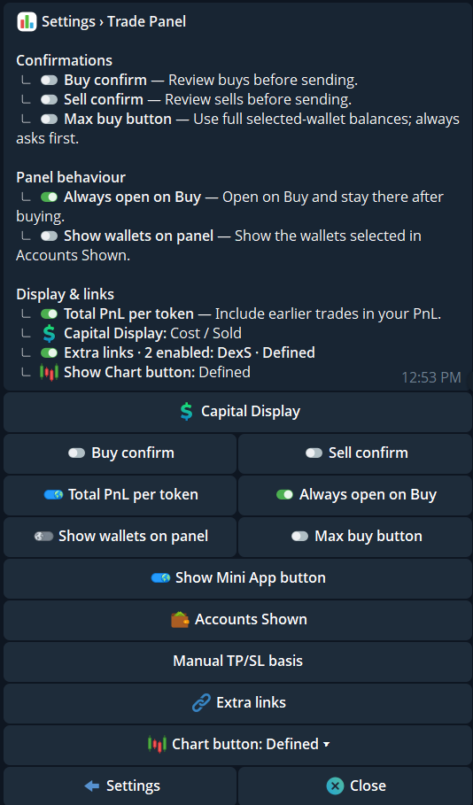
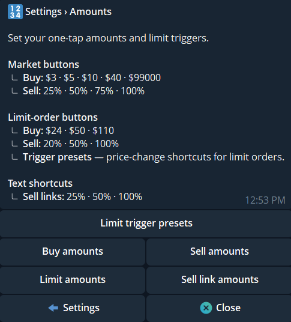
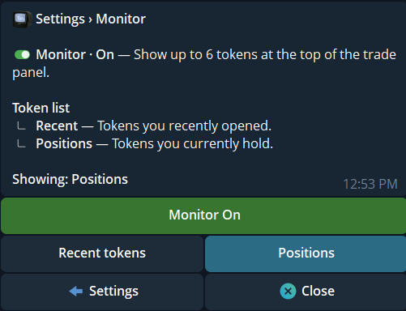

Open `/settings` → **Trade Panel**. You can also use **Customize Trade Panel** from an open token. The current Settings menu puts **Amounts**, **Presets**, **Autobuy**, **Monitor**, and **Auto orders** on the root, so you can reach each directly.

  <Frame caption="Trade Panel groups confirmations, panel behaviour, display, and links. Saved values may differ from this example.">
    
  </Frame>

## Confirmations and panel behaviour

| Control | What it changes |
|---|---|
| **Buy confirm / Sell confirm** | Adds a review before normal market buys or sells. Required safety checks can still appear when these are off. |
| **Max buy** | Shows the option to use full selected-wallet buying power. Max always asks for confirmation. |
| **Always open on Buy** | Opens token panels on Buy and stays there after buying. With it off, a held token may open on Sell. |
| **Show wallets on panel** | Shows wallet rows on the panel instead of nesting them. **Accounts Shown** chooses which wallet rows appear; it does not change which wallets are selected to trade. |

Use **Chart button** to choose **Defined**, **DexS**, or **Off**. **Extra links** controls individual destinations such as DexScreener, Defined, GMGN, Basedbot, X, Pump.fun, and FOMO. **Show Mini App button** controls the Manage Position shortcut.

**Total PnL per token** can include earlier trades in the displayed PnL. **Capital Display** chooses the **Cost / Sold** lines or the summarized **Capital at Risk / Profit Taken** view. These affect the display, not the underlying trades. [PnL and history](/features/history) explains the measures.

## Amounts and limit triggers

Open `/settings` → **Amounts**. This page holds the one-tap values for market buys and sells, Limit orders, and Sell links in the token text. It also opens **Limit trigger presets**.

  <Frame caption="Amounts brings Market buttons, Limit-order buttons, trigger presets, and Sell link amounts into one menu.">
    
  </Frame>

<Steps>
  <Step title="Edit market buttons">
    Open **Buy amounts** or **Sell amounts**, tap a slot, send its new value, and check the updated buttons on a token panel. Buy buttons can use dollar or buying-power percentage mode; sell buttons use a share of the holding.
  </Step>
  <Step title="Edit Limit buttons">
    Open **Limit amounts** for buy USD or sell percentages. Open **Limit trigger presets** to edit the upward or downward market-cap shortcuts. The order form still needs you to review every selected field before creation.
  </Step>
  <Step title="Edit Sell text links">
    Open **Sell link amounts** to change the percentages printed as quick Sell links on token panels. These are separate from the market Sell buttons.
  </Step>
</Steps>

The market Buy buttons start at **\$50 / \$100 / \$250 / \$500 / \$1,000**, or **10 / 25 / 50 / 75 / 100%** in percentage mode. Market Sell buttons start at **25 / 50 / 75 / 100%**. Your saved values may differ. Each relevant list has its own **Reset defaults** control.

Limit Buy and Sell each provide editable trigger and amount slots. Trigger presets can use upward or downward percentages and upward multiples such as **2x**. Buy amounts are USD; sell amounts are percentages. [Order Presets P1–P3](/features/order-presets) save entire forms, rather than one trigger or amount.

[Trader Tracker](/features/trader-alerts#where-the-dollar-buttons-come-from) and [Confluence](/features/confluence#read-and-act-on-the-alert) reuse eligible market Buy and Limit Buy amount buttons. Changing a value affects future alert messages; an already sent alert keeps its captured values.

## Monitor

Open `/settings` → **Monitor**. Turn it on to show a shortcut row with up to **six tokens** at the top of an ordinary market token panel. Choose **Recent** for tokens you recently opened or **Positions** for tokens you hold. The selection is saved even when Monitor is off.

  <Frame caption="Monitor can show recently opened tokens or current positions. This example uses Positions.">
    
  </Frame>

In **Positions** mode, the row follows your `/positions` wallet, chain, hidden/dust, and sort choices. When more tokens are available, use its arrow to see another set. The row appears on the ordinary market Buying or Selling panel, not in Limit, DCA, Strategy, or sub-screens. If the position list cannot be read completely, Cove omits the Positions row. See the [token-panel example](/features/token-panel#monitor-shortcuts).

The related settings have separate guides: [Auto orders](/features/settings/auto-tp-sl), [Autobuy](/features/settings/auto-buy), [Order Presets](/features/order-presets), and [Trading guardrails](/features/settings/guardrails).
