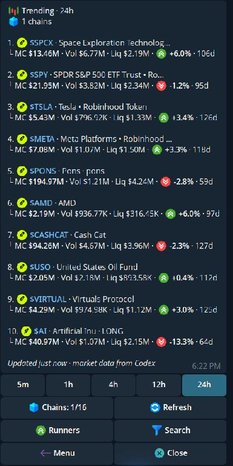
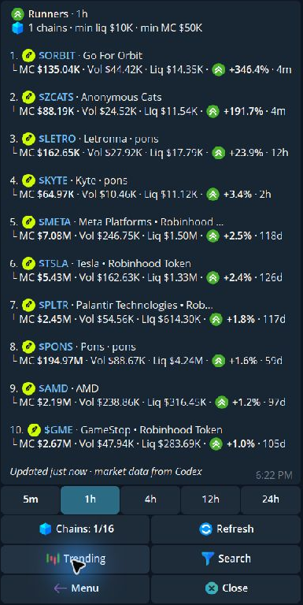
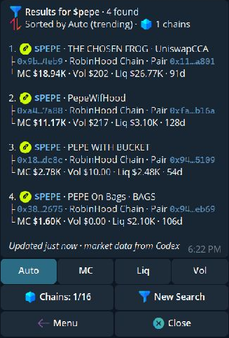

Use Discovery in a private chat with cove. Send `/trending` for tokens drawing activity, `/runners` for tokens with the largest gains in a chosen window, or `/s` to search by ticker or name. These lists help you find a token; they are not trading recommendations or safety checks.

## Trending

1. Send `/trending`.
2. Select **5m**, **1h**, **4h**, **12h**, or **24h**. The selected window is highlighted.
3. Open **Chains** to choose which networks the list covers. The button shows the selected count.
4. Tap **Refresh** for a new list, or choose a token's ticker to open its trading panel.

The rows show market cap (**MC**), trading volume (**Vol**), liquidity (**Liq**), change over the chosen window, and token age when available. **Updated** tells you when the displayed list was refreshed.

  <Frame caption="Trending with the 24h window, chain filter, and refresh control. This account has one chain selected.">
    
  </Frame>

## Runners

Send `/runners`, or tap **Runners** from Trending. Choose the window and chains in the same way. Runners requires at least **\$10,000 liquidity** and **\$50,000 market cap** for a token to appear. The thresholds are shown above the list; they do not guarantee that a trade will execute or that the token is safe.

  <Frame caption="Runners shows its liquidity and market-cap thresholds above the ranked list.">
    
  </Frame>

## Search by ticker or name

1. Send `/s`, or tap **Search** from either list, then reply with a ticker or token name.
2. Read the chain, contract or pair snippet, **MC**, **Vol**, and **Liq** for each result. Several unrelated tokens can share a symbol.
3. Choose **Auto**, **MC**, **Liq**, or **Vol** to change sorting. Use the page controls when more results are available.
4. Tap a result to open its token panel. Verify the full address and chain before trading.

**New Search** starts another query. Pasting a contract address opens the token directly instead of searching by name. Search uses the selected chains shown on the result card.

  <Frame caption="A name search can return several tokens with the same symbol; check the address and chain.">
    
  </Frame>

Discovery lists are briefly cached. If a button says the list expired, reopen `/trending`, `/runners`, or `/s`. A row's market figures can change between the list and the live [token panel](/features/token-panel); review the fresh panel and any [trading guardrails](/features/settings/guardrails).
