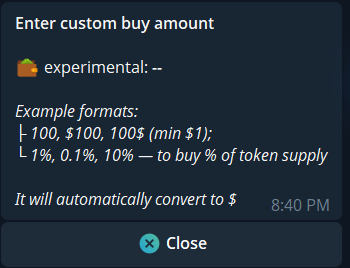
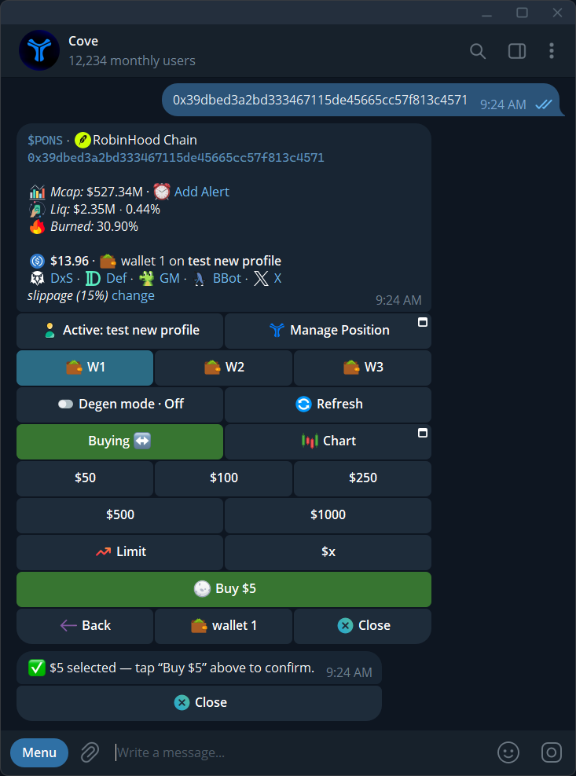
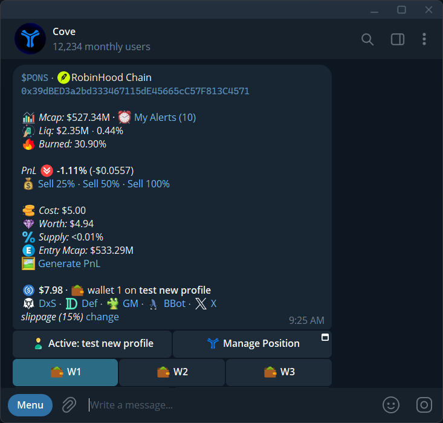
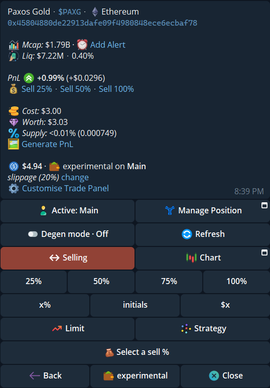
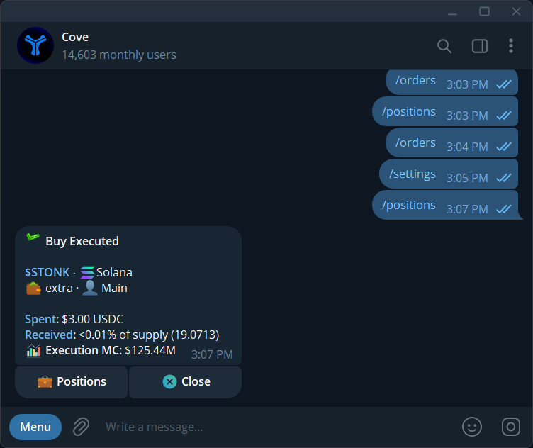
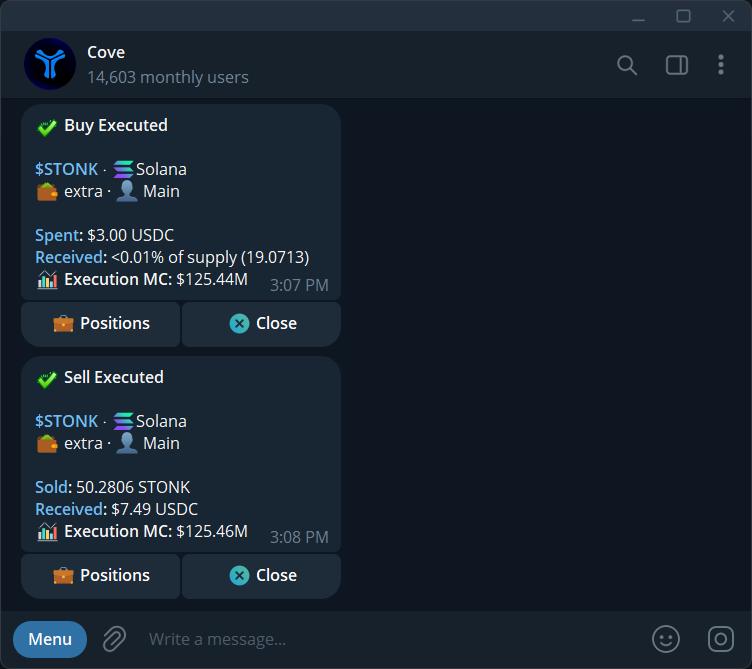

A market trade buys or sells as soon as it can execute at the available quote. It differs from an [automated order](/features/orders-overview), which waits for a trigger.

Use this flow for tokens on **Arc** and other [supported chains](/essentials/supported-chains), with your Cove USDC trading balance.

## Before you trade

Check the **active profile**, **selected wallets**, token address, chain, liquidity, and slippage. If several wallets are selected, check [Spend type](/features/multi-wallet-trading).

<Warning>
**Buy confirm** and **Sell confirm** are off by default. Selecting a preset or entering a custom size can submit a market trade. Enable these in **Settings → Trade panel settings** if you want a separate confirmation.
</Warning>

## Buy a token

<Steps>
  <Step title="Open the token">
    Paste its contract address or a supported token link into Cove. Select the intended chain if prompted.

    For an Arc token, select **Arc** and verify the chain and contract address on the panel before choosing an amount.
  </Step>
  <Step title="Choose Buying">
    Check the panel's side. Open **Buying** if necessary.
  </Step>
  <Step title="Choose a size">
    Select a USD preset, **\$x** for a custom amount, or a percentage preset if you use percentage mode. Percentage-mode buttons use the selected wallets' buying power. The **\$x** prompt can also size a buy by a percentage of token supply, as explained below.

    **Max**, when enabled, uses available buying power and always asks for confirmation.
  </Step>
  <Step title="Review any prompts">
    Confirm the buy if enabled. Read any scam warning, price-impact confirmation, or additional network fee before continuing.
  </Step>
  <Step title="Read the receipt">
    Progress moves through quoting, execution, and verification. **Buy Executed** confirms the fill. Check **Spent**, the actual **Received** token quantity, the approximate share of supply where shown, **Execution MC** where available, and each wallet's outcome.
  </Step>
</Steps>

The documented minimum buy is **\$1**, but it must also clear the chain's sell floor. A token's purchase cap can reduce the actual buy if **Auto-adjust max buy** is on.

### Enter a share of token supply

In the market Buying panel's **\$x** prompt, `100`, `$100`, or `100$` means USD. Enter `1%`, `0.1%`, or another positive percentage up to 100% to request that share of the token's supply. cove estimates a USD amount from the panel's current market cap **for each selected wallet**, then follows the ordinary dollar buy flow and your multi-wallet spend setting. The received share can differ after a fresh quote, price movement, slippage, fees, and token limits. A valid market cap and price are required. This syntax is for the market buy **\$x** prompt, not a Limit, sell, or auto-buy amount.

  <Frame caption="The custom buy prompt accepts USD formats and percentages of token supply.">
    
  </Frame>

{/* Screenshot: trade-buy-confirm.png | With Buy confirm enabled, review the selected amount before tapping Buy. */}

  <Frame caption="With Buy confirm enabled, review the selected amount before tapping Buy.">
    
  </Frame>

{/* Screenshot: trade-position-after-buy.png | The updated token panel after a buy, showing cost, worth, and position PnL. */}

  <Frame caption="The updated token panel after a buy, showing cost, worth, and position PnL.">
    
  </Frame>

## Sell a token

<Steps>
  <Step title="Open your holding">
    Send `/positions`, check the profile, and tap the token.
  </Step>
  <Step title="Choose Selling">
    Select **25%**, **50%**, **75%**, **100%**, **x%** for a custom percentage, or **\$x** for a custom USD value. The four percentages are current defaults; your saved buttons may differ.
  </Step>
  <Step title="Check the scope">
    With several wallets selected, a percentage applies to each wallet's holding. A custom **\$x** sell can also span several wallets: cove uses the same sell fraction of each selected wallet's position, so the requested USD total is allocated in proportion to their holdings. Review the preview and any wallet without a sellable balance.
  </Step>
  <Step title="Submit and check the result">
    Confirm if prompted. Wait for **Sell Executed** and check the token quantity **Sold**, USDC **Received**, **Execution MC** where available, and any partial wallet results. A full sell offers **Generate PnL**.
  </Step>
</Steps>

{/* Screenshot: sell_presets_four_2026_11.png | Selling panel with four percentage presets. */}

  <Frame caption="The default sell row has four percentage buttons; x%, Initials, and $x remain separate controls.">
    
  </Frame>

**Initials** calculates a sell percentage intended to recover the cost basis while leaving the rest of the position. Price movement and costs can change the actual proceeds.

Minimum sells are **\$0.50** on most chains and **\$2.50 on Solana**; some token routes require more. To sell many tokens, use [Bulk sell](/features/bulk-sell).

## Confirmations and results

A receipt may show **Execution MC: --** when Cove cannot measure it reliably. That is an unavailable value, not a zero market cap. The executed token quantity and settled amounts matter more than a pre-trade estimate. A multi-wallet receipt groups wallet outcomes; expand or review each wallet before retrying a failed part.

{/* Screenshot: trade_buy_receipt_2026_10.png | Executed buy with token quantity, share of supply, and Execution MC. */}

  <Frame caption="Executed buy with token quantity, share of supply, and Execution MC.">
    
  </Frame>

{/* Screenshot: trade_sell_receipt_2026_10.png | Executed sell with Sold quantity, Received USDC, and Execution MC. */}

  <Frame caption="Executed sell with Sold quantity, Received USDC, and Execution MC.">
    
  </Frame>

High-impact **buys and sells** may need another confirmation even if normal confirmations are off. A worse refreshed quote can ask you to review again. See [Trading guardrails](/features/settings/guardrails).

A multi-wallet trade can succeed for some wallets and fail for others. A partial fill is different from a full fill; read the amount filled and remaining funds before retrying.

If **Previous order still processing** appears, wait. Closing the chat does not cancel an operation. For failed trades, keep the failure message and its reference for [Support](/features/support).

## Faster entry methods

[Auto-buy on paste](/features/settings/auto-buy) and [Group buy/sell links](/features/settings/group-links) can submit trades immediately when enabled. Quick commands may also be available; send the command without arguments for its current usage before using it.
