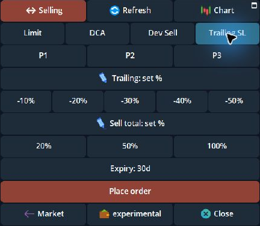

A trailing stop tracks the highest price since you placed it. It attempts to sell when the price falls by the **Trailing %** from that peak.

For example, a 20% trail begins at a peak of 1m market cap with an illustrative 800k threshold. If the peak rises to 1.5m, the threshold rises to about 1.2m. It does not move down just because the price falls.

## Create from the panel

<Steps>
  <Step title="Open a position">
    In the intended profile, open the token and select the wallets whose holdings you want covered.
  </Step>
  <Step title="Open Trailing SL">
    Tap **Limit**, then **Trailing SL**.
  </Step>
  <Step title="Set the trail and amount">
    The required trail and sell-size fields open blank unless you recalled [P1–P3 or Last used values](/features/order-presets). Choose a quick button or enter your own trail from **1–99%** and sell size from **1–100%**. The visible quick buttons are choices, not preselected values.
  </Step>
  <Step title="Review expiry and place">
    Check the displayed settings and expiry, then **Place order**. Default expiry is 30 days, within a 1 minute–30 day range.
  </Step>
  <Step title="Verify the stop">
    Look for **Trailing stop order placed** and open `/orders` in that profile.
  </Step>
</Steps>

{/* Screenshot: trailing_blank_p123_2026_11.png | Trailing SL blank fields and P1–P3. */}
<div className="cove-guide-figure">
  <Frame caption="Trailing SL opens with empty required fields, quick choices, and P1–P3 slots.">
    
  </Frame>
</div>

## Use the reply command

<Warning>Sending the complete reply command places the order immediately. The message itself is the confirmation. The numbers below are illustrative, not a recommended setup.</Warning>

Reply to a **fresh token panel**, rather than sending an unrelated message:

```text
/trailing 50 100
```

This example trails the peak by **50%** and sells **100%** of selected wallets' holdings. Both numbers are required.

Send `/trailing` alone for the bot's tutorial. If it reports duplicate delivery or uncertain partial creation, check `/orders` before resending.

## Change or cancel

Open `/orders`, select the pending trailing stop, and use **Edit** or **Cancel**. You can edit the trail, sell size, and expiry while pending.

If a trail is too tight and would trigger immediately, widen it. A trigger is not a guaranteed fill; read any **Didn't Fire**, fee, or failed-order notice in [Manage orders](/features/managing-orders).
