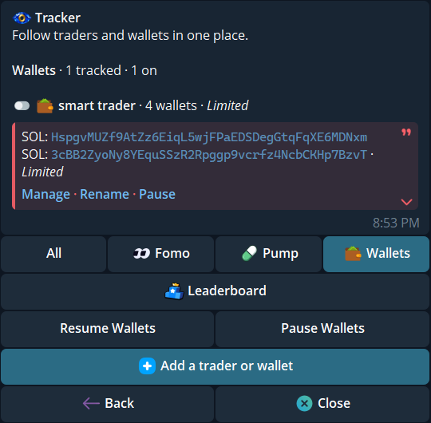
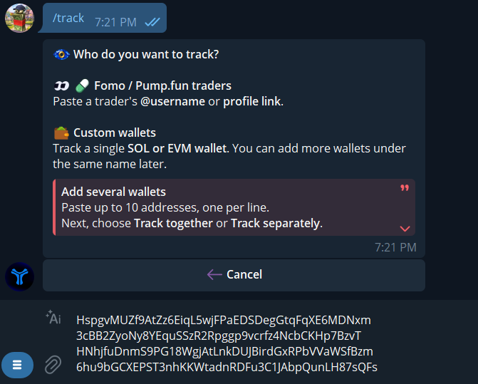
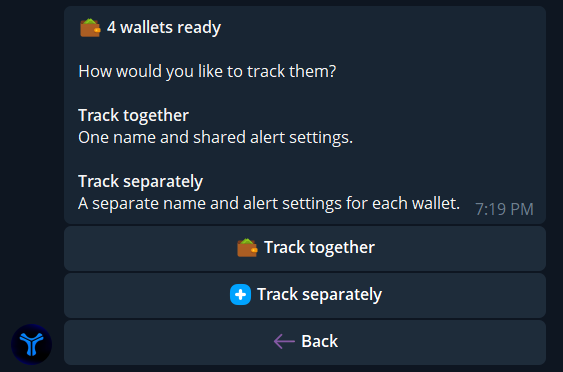
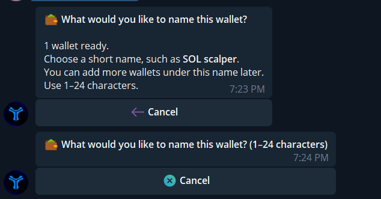
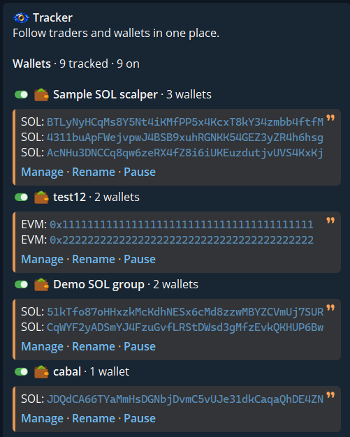
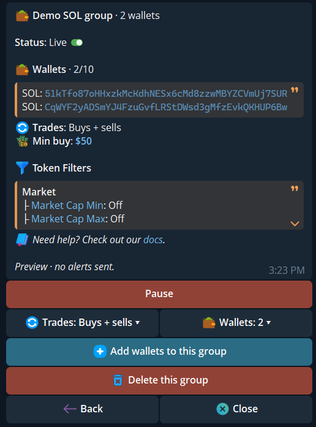
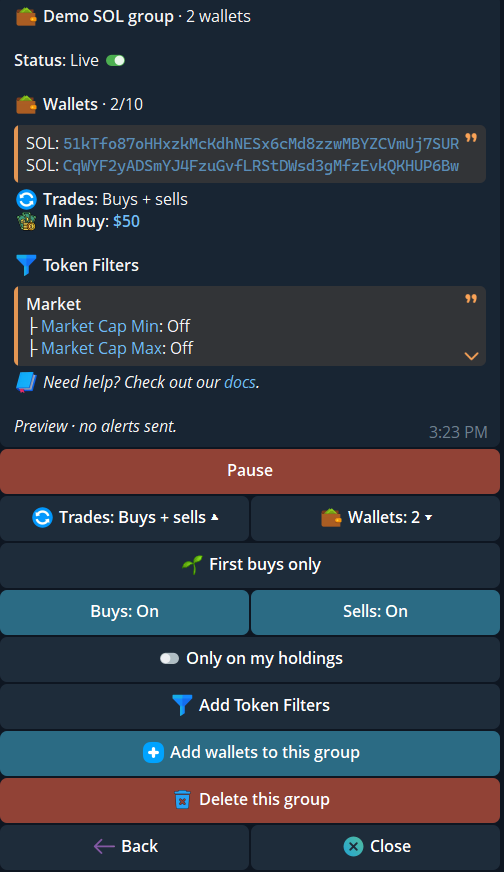
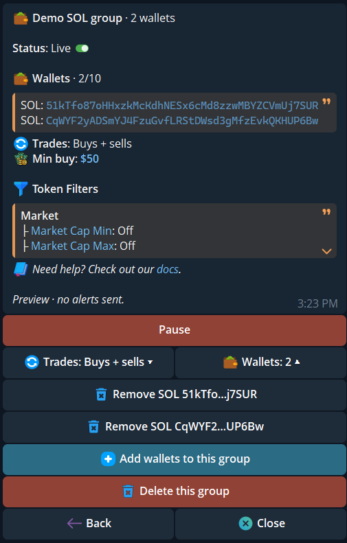

The unified Tracker can follow public wallet addresses alongside Fomo and Pump.fun traders. Send `/track`, then open **Wallets**. These tracked wallets are separate from the wallets you own in `/wallets` and from your [trading profiles](/essentials/profiles).

  <Frame caption="The Wallets tab shows a tracked group, its status, and the shared Add a trader or wallet action.">
    
  </Frame>

## Add one wallet or a batch

1. Tap **Add a trader or wallet**. Send a **public** Solana or EVM address to track a wallet. An `@handle` or supported profile link searches for a Fomo or Pump.fun trader instead. Never send a private key or recovery phrase.
2. For a batch, paste up to **10 addresses**, one per line. The bot checks every line before showing the next step. An invalid, duplicate, already tracked, or over-limit address rejects the whole batch; no entries are saved from it.
3. If you sent one address, give it a name of **1–24 characters**. You can attach more wallets to that name later.
4. If you sent several unnamed addresses, choose **Track together** for **one name and shared alert settings**, or **Track separately** for **one name and alert setup per wallet**. Together asks for a 1–24 character name. Separately asks for a 1–20 character base name and creates entries such as `Custom #1`, `Custom #2`.
5. Review the new entries in **Wallets → Manage**. A new wallet may show **Checking** until monitoring is ready.

  <Frame caption="The common add prompt accepts one public address or several addresses, one per line.">
    
  </Frame>

  <Frame caption="After four valid addresses, choose one shared group or a separate entry for each wallet. This choice does not start a trade.">
    
  </Frame>

  <Frame caption="A single wallet asks for a short name. A batch tracked together asks for one group name in the same 1–24 character range.">
    
  </Frame>

You can also name addresses in the input with `address; name` on **every** line; a comma works too. Identical names form one group. Mixing named and unnamed lines is refused. In the unified Tracker you can save up to **10 wallet names**, **10 wallets per name**, and **10 addresses per input**. Names must be unique regardless of letter case.

## Read the Wallets tab

The **Wallets** tab counts tracked wallets and shows how many are on. Addresses appear under their group name. Each group has **Manage**, **Rename**, and **Pause** or **Resume**. These actions affect alerts, not the assets in the public wallets you follow.

  <Frame caption="Several named groups in Wallets. Each group lists its public addresses and its own management controls.">
    
  </Frame>

## Manage a group

Tap **Manage** under a group. The card shows **Status**, member count, trade-alert mode, **Min buy**, and active **Token Filters**. In the example, **Wallets · 2/10** means two addresses occupy the group's ten slots. **Live** means monitoring is active for the shown coverage; read any network-specific status before relying on an alert. **Pause** stops new alerts while keeping the name, members, and settings.

  <Frame caption="Manage for a two-wallet group, with Live status, shared alerts, filters, and add or delete controls.">
    
  </Frame>

### Trade alerts and filters

Open **Trades** to choose **Buys**, **Sells**, **First buys only**, and **Only on my holdings**. **Min buy** filters purchases made by the **tracked wallet**; it does not set the size of your own Buy or Limit action. Open **Add Token Filters** for market-cap and other token bounds. These choices are shared by all wallets under the group name. Wallet groups do not have trader **Theses**.

  <Frame caption="The expanded Trades menu shows buy and sell alerts, first buys, holdings, and token-filter controls.">
    
  </Frame>

### Add or remove wallets

Tap **Wallets: N** inside Manage to expand the member list. **Remove** beside an address stops tracking **that wallet** while the other members and their group settings stay in place. **Add wallets to this group** accepts public addresses only, up to the group's remaining slots; do not add names to this input. **Delete this group** removes its name, members, and alert settings. Removing the final wallet also deletes the group after a warning. Check the confirmation before removing either.

  <Frame caption="The expanded Wallets menu has a separate Remove action for each address, plus group-level Add and Delete actions.">
    
  </Frame>

## Coverage and wallet statistics

Read each wallet's **Coverage** state. **Checking** means monitoring is being set up; **Limited**, **Unsupported**, or **Unavailable** is not the same as **Live**. Alerts cover supported same-chain buys and sells after monitoring starts. Earlier trades and activity during a pause are not replayed. Cross-chain trades, transfers, token-to-token swaps, escrow, and derivatives are outside this wallet alert feed.

Where wallet statistics are available, the card shows **realized trading PnL** for **24h**, **7d**, and **30d**, an update time, and a group total. These figures come from indexed wallet trades, independently of which alert chains you selected. They are not your cove portfolio PnL. A missing wallet figure can make the group total unavailable, shown as **—**; a partial or older update should be read with its displayed status and time.

A wallet alert can offer the same **Buy**, **Limit**, or eligible **Sell** controls described in [Trader Tracker](/features/trader-alerts#act-on-an-alert). An alert never trades automatically. Check the token, selected wallets, and the current quote before acting.
