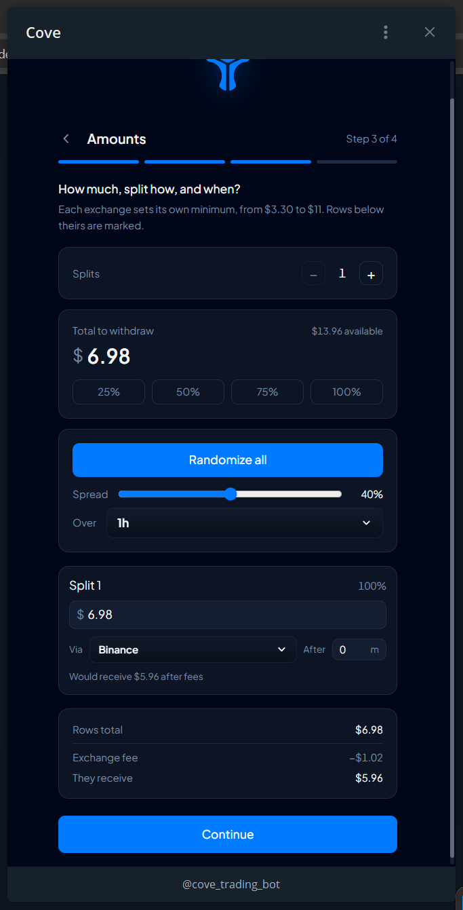

Private Withdraw routes a payment through exchanges, with optional splits and delays, to **one external address**. You pay from **Solana USDC**; where the output-asset choice is enabled, the recipient can receive a supported stablecoin or the network's native asset.

<Note>This feature is available only on enabled accounts. Look for **Private Withdraw** in `/withdraw`. Standard [Withdraw](/funds/withdraw) remains the alternative.</Note>

## Create a private withdrawal

<Steps>
  <Step title="Choose the paying wallet">
    Open `/withdraw` → **Private Withdraw**. In Cove Wallets, choose a source holding **Solana USDC**.
  </Step>
  <Step title="Enter the destination">
    Under **Where does it go?**, enter the address and select its network. Where offered, select the asset the recipient will receive. Check the address, network, and asset carefully.
  </Step>
  <Step title="Set the total and splits">
    Choose **1–5 splits**, the total amount, and any **Randomize**, **Spread**, or **Over** options. Review each exchange, minimum, and delay.

    {/* Screenshot: private-withdraw-amounts.png | Step 3: configure the withdrawal total, splits, exchanges, and delays before final review. */}
    

      <Frame caption="Step 3: configure the withdrawal total, splits, exchanges, and delays before final review.">
        
      </Frame>
    

  </Step>
  <Step title="Review and send">
    Check destination, network, receive asset, **You send** in Solana USDC, **They receive** in the selected asset, **Exchange fee**, and final estimated delivery. Use **Withdraw** with the displayed payment amount to submit.
  </Step>
</Steps>

## Networks and fees

The documented destination networks are **Solana, Base, Ethereum, BNB Chain, and Arbitrum**. Only matching address/network combinations are offered. **USDC** is the default receive asset. Where output assets are enabled, the supported choices are:

| Network | Receive assets |
|---|---|
| Solana | USDC, SOL, USDT |
| Ethereum | USDC, ETH, USDT |
| Base | USDC, ETH |
| BNB Chain | USDC, BNB, USDT |
| Arbitrum | USDC, ETH, USDT |

The live panel may offer fewer choices depending on feature availability. Changing the receive asset requires a fresh quote. Non-USDC receive amounts are shown in their own units; do not read a SOL, ETH, or BNB amount as dollars. The earlier screenshot below shows the default USDC route.

Cove does not add an app fee for Private Withdraw. Exchange fees and route minimums are shown before confirmation and vary by network and provider. Check the final quote for the amount you will receive.

## Track and resolve

With [2FA](/features/settings/security) enabled, approve the reviewed private withdrawal with a fresh authenticator code. Check the run status before retrying an uncertain payment.

Reopen the run for per-split progress, **Send now**, or **Track on Husher**. Telegram reports sent, complete, partially complete, or failed.

If a split fails, open [Support](/features/support) with the withdrawal reference to arrange the next step or refund. Other splits may already have arrived. A pause on new withdrawals does not stop ones already underway.

If the provider rejects the address or cannot confirm the minimum, check the error and contact support if needed. Do not repeatedly submit the same withdrawal.

<Warning>
A sent payment cannot be recalled. Routing is not a guarantee of anonymity. Check the recipient, network, costs, and total before sending.
</Warning>
