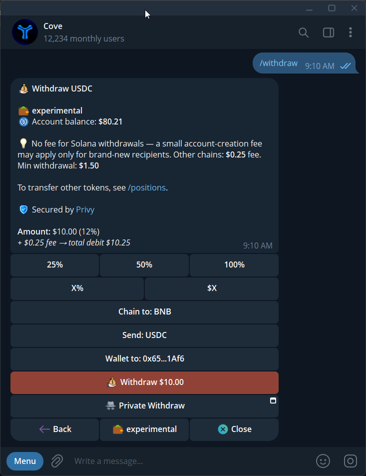
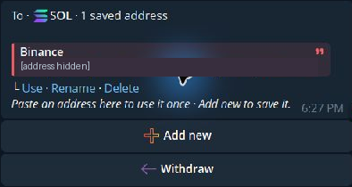
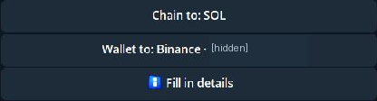
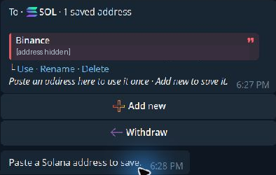

Use **Withdraw** for money going to an external address. Use [Transfer](/features/transfers) between your Cove wallets or to a Cove user. To send another token, use [Token transfers](/funds/token-transfers).

If [2FA](/features/settings/security) is on, confirm an external withdrawal with a fresh authenticator code after reviewing the amount and destination.

## Make a withdrawal

<Steps>
  <Step title="Open Withdraw">
    Choose the intended profile and send `/withdraw`. Check the source wallet and available balance.
  </Step>
  <Step title="Choose the network and asset">
    Select the destination chain. Solana and BNB Chain may also offer **Send: USDT**. Make sure the recipient accepts the exact asset and network.
  </Step>
  <Step title="Enter the destination">
    Tap **Wallet to** to choose a saved address or **Add new**. You can also paste an external address for this withdrawal without saving it. Review any address warning and check the full address yourself.
  </Step>
  <Step title="Enter an amount">
    Choose a USD amount or percentage. The minimum withdrawal is **\$1.50**. Leave room for any fee when entering an amount below Max.
  </Step>
  <Step title="Review and submit">
    Check the source, destination, chain, asset, fee, and recipient amount. If a fee confirmation appears, review it before **Withdraw anyway** or the final action shown.
  </Step>
  <Step title="Track completion">
    **Withdrawal Submitted!** means processing has started. Wait for the completion or failure message and check the explorer link where provided.
  </Step>
</Steps>

{/* Screenshot: withdraw-form.png | A withdrawal form with the source, network, recipient, amount, fee, and final action. */}

  <Frame caption="A withdrawal form with the source, network, recipient, amount, fee, and final action.">
    
  </Frame>

{/* Screenshot: withdraw-review.png | Подтверждение: fee, сумма получателю, сеть и Withdraw anyway; адрес замаскировать. */}

## Save and reuse a destination

After choosing a chain in `/withdraw`, tap **Wallet to**. The address book lists saved destinations for that chain with **Use**, **Rename**, and **Delete**. Tap **Add new** and send a public destination address to save it; cove then asks for a name. Pasting an address directly into the withdrawal flow uses it once without adding it to the book.

  <Frame caption="The Solana address book offers Use, Rename, Delete, and Add new. The saved address is hidden here.">
    
  </Frame>

  <Frame caption="Use fills Wallet to with the saved label; the destination address is hidden in this example.">
    
  </Frame>

  <Frame caption="Add new asks for a Solana address before it is saved; the existing destination is hidden.">
    
  </Frame>

You can save up to **10 addresses per login** across all profiles and networks combined. An EVM address is shared among EVM withdrawal chains; a Solana address appears only on Solana. Names are unique within their EVM or Solana group. Choosing a different chain clears the selected destination, so select it again and check the asset and network. Deleting an EVM entry removes it from every EVM chain after confirmation.

A saved address receives the **same address checks, fee review, and fresh 2FA code** as a pasted address. Saving it does not authorize a future withdrawal. The address book is for the Telegram USDC/stablecoin `/withdraw` flow; token transfers from `/positions` use their own destination flow.

## Fees and Max

Standard Solana withdrawals have no flat Cove withdrawal fee; a new recipient token account may have an account-creation cost. Other supported withdrawal chains have a documented **\$0.25** flat fee. Check the current prompt for the final amount.

- Below **100%**, the fee is added on top of the entered amount.
- At **100% / Max**, it is taken from the amount, reducing what arrives.
- **Withdrawal Too Large to Sponsor** asks you to split the withdrawal into smaller amounts.

See [Fees and minimums](/essentials/fees-structure).

## Supported destinations

Open **Withdraw** to see the destination networks currently offered. The [Supported chains](/essentials/supported-chains) page lists trading networks, including **Arc**; trading support does not automatically mean a chain is available as a withdrawal destination.

## If a withdrawal is blocked

| Message or situation | Next step |
|---|---|
| Destination is your own Cove wallet | Use **Transfer** |
| Invalid or unsupported destination | Recheck the address, network, and recipient requirements |
| Address looks like a token contract | Use the recipient's wallet address |
| Insufficient balance | Reduce the amount or add spendable funds |
| Signing access lost | Restore access in Cove Wallets |
| Submitted or pending | Follow the existing receipt before starting another withdrawal |

[Private Withdraw](/funds/private-withdraw), where available, has a separate flow and fee quote.
